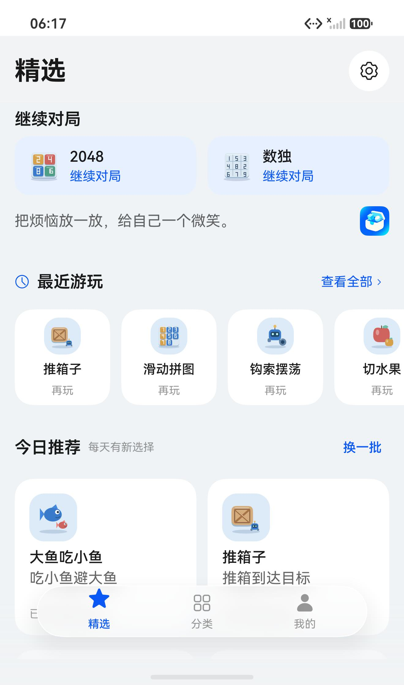
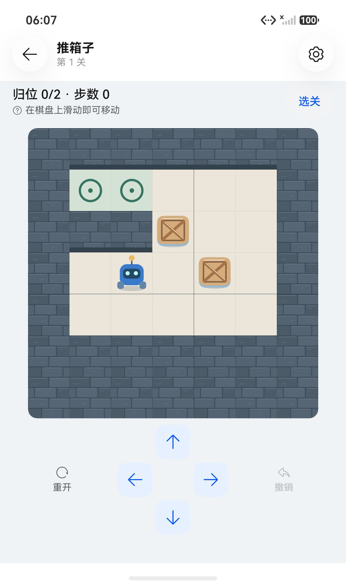
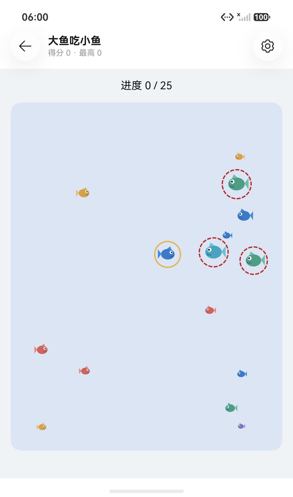

# 玩趣盒 · PocketJoy

玩趣盒把 60 款单人小游戏装在一起。在鸿蒙手机或平板上，可以离线推箱子、拆螺丝、下象棋，也可以把没做完的数独留到下次继续。玩游戏无需注册账号，游玩记录和成绩都保存在当前设备。

**适用设备**　HarmonyOS 6.1.1 及以上的手机和平板。

**[下载玩趣盒 v1.1.1（未签名 HAP，约 8 MB）](https://github.com/wujiyan19/PocketJoy/releases/download/v1.1.1/LittleGames-1.1.1-release-unsigned.hap)** · [下载与安装](#下载与安装) · [玩法目录](#玩法目录)

## 下载与安装

**推荐用轻启·安装器（QSStore）。** 下载的 HAP 需要先签名，手机的文件管理器无法直接安装。用轻启选中这个文件后，它会用你账号下的调试证书签名，再装到本机。[轻启项目主页](https://github.com/thx853068675-dev/QSStore)

### 已经装好轻启

1. 在准备玩游戏的设备上下载文件 **`LittleGames-1.1.1-release-unsigned.hap`**。[下载 HAP](https://github.com/wujiyan19/PocketJoy/releases/download/v1.1.1/LittleGames-1.1.1-release-unsigned.hap)
2. 第一次用轻启签装时，在轻启的**「我的」**登录华为开发者账号。按提示开启系统无线调试，在轻启中输入系统显示的端口并连接本机，再按系统提示确认信任。已经配置过的设备可直接进行下一步。
3. 在轻启点**「本地」→「从本地签装」→「选择安装文件」**，选中刚下载的 HAP。确认显示的是「玩趣盒」和版本 **1.1.1**，点**「安装」**。完成后，从桌面打开玩趣盒。

### 还没装轻启

轻启作者提供过手机邀测安装，旧邀请已有人反馈过期，可先看作者是否更新了入口。GitHub 上的轻启安装包也需要签名，手边有电脑的话，可以直接按电脑指南安装玩趣盒。[轻启作者的首次安装说明](https://github.com/thx853068675-dev/QSStore/issues/1#issuecomment-6119712334) · [用电脑安装玩趣盒](docs/release/v1.1.1-INSTALL.zh-CN.md)

装好轻启后，按上面的[「已经装好轻启」](#已经装好轻启)步骤选择玩趣盒安装包。

### 从旧版升级并保留存档

覆盖安装需要沿用给旧版签名的那张证书。如果上次是用轻启安装，请先登录原来的华为开发者账号。遇到**「确认清除应用数据」**时，选**「保留并跳过」**，旧版和存档会留在设备上，等换回原签名后再升级。

## 打开后玩什么

| 精选与续玩 | 推箱子 | 大鱼吃小鱼 |
| :---: | :---: | :---: |
|  |  |  |

- **想解一道题**　推箱子有 12 道固定关和随机关卡。箱子只能往前推，哪只先动很重要。喜欢数字的话，数独填满后会标出重复的位置，方便回头检查。
- **想动动手**　拖动带金环的小鱼觅食，绕开带红色虚线环的大鱼。也可以试试钩索摆荡，抓住锚点后挑准时机松手，看看能飞多远。
- **想下盘棋**　中国象棋和国际象棋都可以离线对战电脑。想找某一款，在**「分类」**里直接搜名字；想接着玩 2048 或数独，在**「精选」**点**「继续对局」**。

## 玩法目录

共有 **60 款游戏、65 种玩法**。数学挑战里可以选心算、比大小、数列、二进制或补数，节奏落键里可以选四轨落键或三键节拍跳跃。

查看全部 60 款游戏

| 分类 | 款数 | 游戏 |
| --- | ---: | --- |
| 街机休闲 | 13 | 贪吃蛇、俄罗斯方块、打砖块、彩泡弹射、落果合成、黑洞吞噬、大鱼吃小鱼、滚动球闯关、纵向战机、坦克对战、自动攻击生存、爬坡越野、休闲钓鱼 |
| 逻辑解谜 | 23 | 扫雷、滑动拼图、华容道、宝石三消、十字熄灯、色块归一、迷宫寻路、汉诺塔、跳子独留、数字绘格、方块拼填、堆叠三消、倒水排序、箭头清除、拆螺丝、停车场挪车、推箱子、连连看、麻将接龙、点击群消、乘客上车、绳结解开、图片拼图 |
| 棋盘对弈 | 5 | 经典纸牌、中国象棋、国际象棋、蜘蛛纸牌、空当接龙 |
| 数字训练 | 4 | 2048、数独、猜数字、数学挑战 |
| 记忆专注 | 4 | 记忆翻牌、数字寻序、顺序记忆、旋律记忆 |
| 反应节奏 | 11 | 打地鼠、信号反应、跑酷闯关、节奏落键、横版跳跃闯关、钩索摆荡、飞行穿柱、切水果、挡板对战、单键漂移、空气曲棍球 |

v1.1.1 更新了 65 种玩法的对局背景。完整改动见[版本说明](docs/release/v1.1.1.md)，从源码运行的步骤见[安装指南](docs/release/v1.1.1-INSTALL.zh-CN.md#用对应源码在-deveco-studio-运行)。
