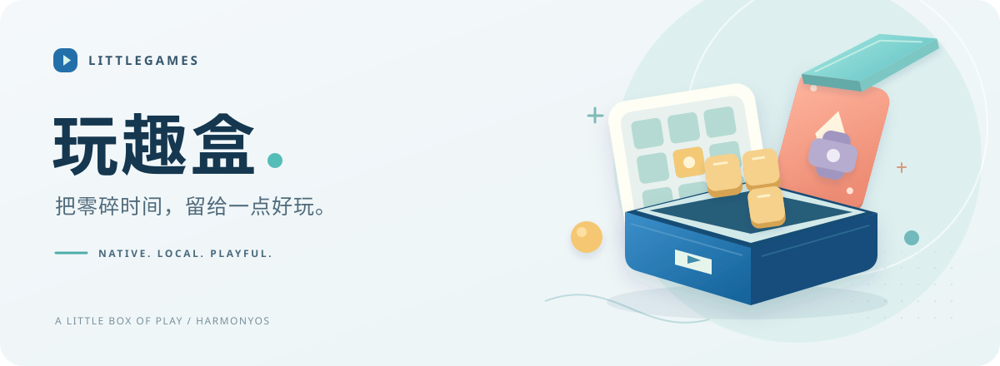
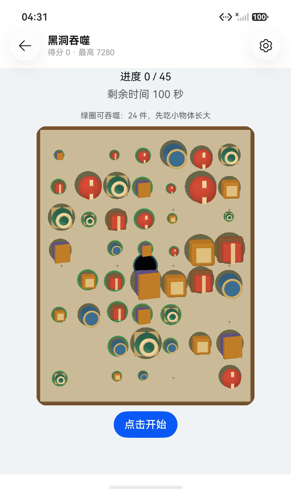
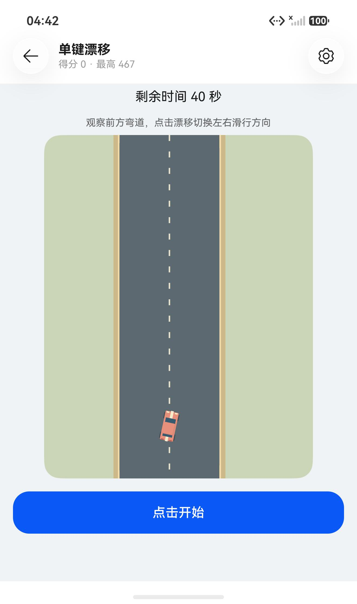

<p align="center">
  
</p>

<div align="center">

# 玩趣盒 · LittleGames

**把零碎时间，留给一点好玩。**

一个基于 ArkTS / ArkUI 的 HarmonyOS 原生单人小游戏合集。<br>
本地游玩，原生交互，把每次进步留在自己的设备上。

**64 个入口** &nbsp; · &nbsp; **69 个原有玩法** &nbsp; · &nbsp; **6 大分类**

HarmonyOS API 26 / 最低兼容 API 24<br>
简体中文 / English

[体验画面](#体验画面) &nbsp; / &nbsp; [玩法目录](#玩法目录) &nbsp; / &nbsp; [运行项目](#运行项目) &nbsp; / &nbsp; [文档导航](#文档导航)

</div>

> [!IMPORTANT]
> **开发验证中，尚未上架。** 华为开发者联盟已答复，暂不支持所咨询的小游戏合集形态上架。当前 64 入口版本未获得新的准入确认。仓库展示工程实现与验证进展，具体范围见[发布状态](docs/release/status-2026-10-27.md)。

## 体验画面

简洁的造型、柔和的配色和固定镜头，让棋盘与操作成为主角。

<table>
  <tr>
    <td align="center" width="33%">
      <a href="docs/device-acceptance/screwout-difficulty-2026-10-19-emulator/README.md"></a><br>
      <strong>拆螺丝</strong><br>
      <sub>层叠遮挡 · 同色回收</sub>
    </td>
    <td align="center" width="33%">
      <a href="docs/device-acceptance/toy-chase-2026-10-21-emulator/README.md"></a><br>
      <strong>黑洞吞噬</strong><br>
      <sub>原生三维 · 逐步成长</sub>
    </td>
    <td align="center" width="33%">
      <a href="docs/device-acceptance/toy-chase-2026-10-21-emulator/README.md"></a><br>
      <strong>单键漂移</strong><br>
      <sub>观察弯道 · 把握换向</sub>
    </td>
  </tr>
</table>

<p align="center"><sub>以上为 API 26 模拟器历史画面：拆螺丝摄于 2026-10-19，黑洞与漂移摄于 2026-10-21。点击画面查看对应验证记录；截图不代表当前版本完整验收。</sub></p>

## 不止是开一局

<table>
  <tr>
    <td width="50%" valign="top">
      <h3>随手开始</h3>
      <p>无需游戏账号，本机单人游玩。推荐可换批，目录可搜索；中国象棋与国际象棋支持离线电脑对战。</p>
    </td>
    <td width="50%" valign="top">
      <h3>留住进步</h3>
      <p>成绩、时长与游玩历史留在本机。数独和 2048 可续玩；合并模式的旧记录承接到主入口。</p>
    </td>
  </tr>
  <tr>
    <td width="50%" valign="top">
      <h3>舒服地玩</h3>
      <p>浅深主题、音效、震动与退出确认。部分场景使用玩具风格素材或 ArkGraphics 3D 原生绘制。</p>
    </td>
    <td width="50%" valign="top">
      <h3>融入系统</h3>
      <p>推荐与续玩卡片、成绩图片分享、API 26 原生材质。真实跨设备接续与碰一碰传输仍待验收。</p>
    </td>
  </tr>
</table>

## 玩法目录

当前开放 **64 个独立入口**。数学挑战承载五种题型，节奏落键承载两种模式，因此保留 **69 个原有玩法**。这里的“玩法”按原有规则模式统计，不代表 69 个独立应用。

<details>
<summary><strong>展开六大分类与完整入口清单</strong></summary>

| 分类 | 入口 | 游戏 |
| --- | ---: | --- |
| 街机休闲 | 16 | 贪吃蛇、俄罗斯方块、打砖块、泡泡龙、落果合成、黑洞吞噬、大鱼吃小鱼、房间塔防、迷你餐厅、滚动球闯关、雷电战机、坦克对战、射击守城、自动攻击生存、爬坡越野、休闲钓鱼 |
| 逻辑解谜 | 24 | 扫雷、滑动拼图、华容道、消消乐、十字熄灯、色块归一、迷宫寻路、汉诺塔、跳子独留、数字绘格、方块拼填、堆叠三消、倒水排序、箭头清除、拆螺丝、停车场挪车、推箱子、连连看、麻将接龙、点击群消、乘客上车、毛线收卷、绳结解开、图片拼图 |
| 棋盘对弈 | 5 | 经典纸牌、中国象棋、国际象棋、蜘蛛纸牌、空当接龙 |
| 数字训练 | 4 | 2048、数独、猜数字、数学挑战 |
| 记忆专注 | 4 | 记忆翻牌、数字寻序、顺序记忆、旋律记忆 |
| 反应节奏 | 11 | 打地鼠、信号反应、跑酷闯关、节奏落键、横版跳跃闯关、钩索摆荡、飞行穿柱、切水果、挡板对战、单键漂移、空气曲棍球 |

数学挑战包含心算、比大小、数列、二进制、补数；节奏落键包含四轨落键和三键节拍跳跃。新成绩按模式与适用难度分别保存。

目录以 [GameAvailability.ets](entry/src/main/ets/common/GameAvailability.ets)、[GameModes.ets](entry/src/main/ets/common/GameModes.ets) 和 `GameDataManager.getAllGames()` 为准。暂撤项保留底层模型、资源与原始战绩，不再作为当前公开入口。

</details>

2026-10-27 的收敛与整改包括暂撤 7 款、合并 5 个入口，以及 26 款保留项的规则与复玩改进。逐项变化见[整改执行记录](docs/game-retention-implementation-2026-10-27.md)，判断依据见[全游戏审核](docs/game-retention-audit-2026-10-27.md)。

## 运行项目

### 1. 准备工具

使用 **DevEco Studio 26.0.0.851 / API 26 SDK**，打开仓库根目录并完成工程同步。编译与目标版本为 `26.0.0`，最低兼容版本为 `6.1.1(24)`；旧版 API 24 SDK 无法构建当前工程。

本机默认工具链位于 `C:/Program Files/Huawei/DevEco Studio/`。命令行入口会使用其中的 Node、Hvigor、SDK、ohpm 与 JBR；工程根目录没有 `hvigorw`。

### 2. 构建与运行

在仓库根目录执行：

```powershell
# Debug
node scripts/build-hap.cjs

# Release 编译模式
node scripts/build-hap.cjs release
```

产物位于 `entry/build/default/outputs/default/`。共享配置不包含个人签名，未配置本机签名时生成 unsigned HAP；连接真机前，在 DevEco Studio 配置调试签名。也可启动 Local Emulator，在 IDE 中选择设备后运行。

Release HAP 构建与正式上架 App Pack、发布签名及市场准入是不同步骤，当前发布限制见[发布状态](docs/release/status-2026-10-27.md)。

<details>
<summary>独立工具链与环境配置</summary>

- `LITTLEGAMES_TOOLCHAIN_ROOT`：指定独立 `command-line-tools` 目录；本机保留 `.local-tools/harmonyos-26.0.0.851/command-line-tools/`。
- `JAVA_HOME`：指定其他兼容 JDK。本机 IDE 内置 JBR 25.0.2 已有签名构建记录。
- 构建入口仅为子进程配置环境。证书、私钥、Profile 和口令保留本地，不随源码分发。
- API 26 升级与工具链详情见[升级实施记录](docs/api26-upgrade-implementation-2026-10-18.md)和 [IDE 验证记录](docs/device-acceptance/api26-upgrade-2026-10-18/ide/REPORT.md)。

</details>

### 3. 运行桌面检查

```powershell
# 将验证输出留在构建清理范围之外
$env:LITTLEGAMES_REGRESSION_OUTPUT = "$PWD/.local-tools/regressions"
node scripts/run-regressions.cjs
```

运行器当前包含 **32 套检查**，直接执行转换后的 Model / ViewModel，并替代原生服务与时钟。它验证规则与状态流转；ArkTS 编译、设备渲染、触控和性能分别验收。可用 `ARKTS_TYPESCRIPT_PATH` 指定工具链中的 `ohpm/node_modules/typescript/lib/typescript.js`。

## 验证进展

以下是已有记录的范围，**不是本页更新时重新执行的测试结果**。

| 验证层次 | 最近记录 | 适用范围 |
| --- | --- | --- |
| 桌面逻辑 | 2026-10-27 · 32 套，1400/1400 通过 | 64 入口版本；含合并模式、旧数据承接、42 份旧模型快照恢复，以及 630 局公开输入控制样本。部分检查仍覆盖暂撤模型。 |
| 原生构建 | 2026-10-27 · API 26 Debug / Release 成功 | 包哈希与源码指纹有记录；这一轮未安装新包，尚未完成对应设备复验。 |
| 真实界面 | 历史手机与模拟器记录 | 只证明报告对应包、设备和操作范围；不代表当前 64 入口版本全量通过。 |

当前工程结果可追溯至[整改执行记录](docs/game-retention-implementation-2026-10-27.md)、[源码与包回执](docs/game-retention-audit-2026-10-27/implementation/receipt.json)和[桌面验证汇总](docs/game-retention-audit-2026-10-27/implementation/verified-regressions/verification.json)。

仍待补齐：当前版本逐款真机操作与结算、音效试听、长局帧率与内存、温升耗电、英文与最大字体、无障碍、窗口变化，以及真实跨设备接续／传输。工程声明支持 phone / tablet，实际覆盖以设备报告为准。

## 工程一览

```text
AppScope/                  应用身份与品牌图标
entry/src/main/
├── ets/
│   ├── common/            目录策略、模式、主题、声音与共享能力
│   ├── components/        共用界面与原生三维场景
│   ├── model/             游戏目录、规则与本地数据
│   ├── pages/             精选、分类、游戏、战绩与设置
│   └── router/            导航与入口映射
└── resources/             多语言、浅深主题、音效与美术
scripts/                   构建、规则回归、素材与设备验证工具
docs/                      产品审阅、实现说明与分版本证据
```

主界面采用 `@ComponentV2`、`@Local`、`Navigation / NavPathStack` 与 `GridRow`。运行时没有第三方依赖，当前模块仅声明振动权限；不提供真人多人、局域网房间或开发者自建云存档。

## 文档导航

| 想了解什么 | 从这里开始 |
| --- | --- |
| 当前玩法与整改 | [64 入口整改记录](docs/game-retention-implementation-2026-10-27.md) · [去留审核](docs/game-retention-audit-2026-10-27.md) |
| 画面、素材与声音 | [玩具风格](docs/art/toy/README.md) · [黑洞与漂移](docs/art/toy/chase/README.md) · [游戏音效](docs/game-sounds.md) · [美术索引](docs/art/README.md) |
| 系统能力 | [API 26 升级](docs/api26-upgrade-implementation-2026-10-18.md) · [卡片、光感与分享](docs/device-acceptance/api26-features-2026-10-18/REPORT.md) · [接续说明](docs/harmonyos-continuation-immersive-light.md) |
| 设备与发布 | [设备证据索引](docs/device-acceptance/README.md) · [发布状态](docs/release/status-2026-10-27.md) |

<details>
<summary>历史版本与开发过程</summary>

- [2026-10-19：76 款目录与提交验证](docs/delivery-2026-10-19.md)
- [2026-10-19：游戏去留审阅](docs/game-retirement-review-2026-10-19.md)
- [2026-10-13：单人功能迭代](docs/feature-iteration-2026-10-13.md)
- [2026-10-12：89 款单人范围](docs/single-player-scope-2026-10-12.md)
- [早期 100 款扩充与验证](docs/game-expansion-100/verification.md)
- [2026-10-14：发布与激励调研](docs/release/publishing-and-incentive-guide-2026-10-14.md)

历史文档中的 100 / 89 / 79 / 76 款数量、多人能力与发布计划，按各自日期理解；其中的旧状态不代表当前目录或平台准入结论。

</details>

---

<p align="center"><strong>认真做一点小小的好玩。</strong><br><sub>LittleGames · 玩趣盒 · 基于当前实现与分版本验证记录整理</sub></p>
